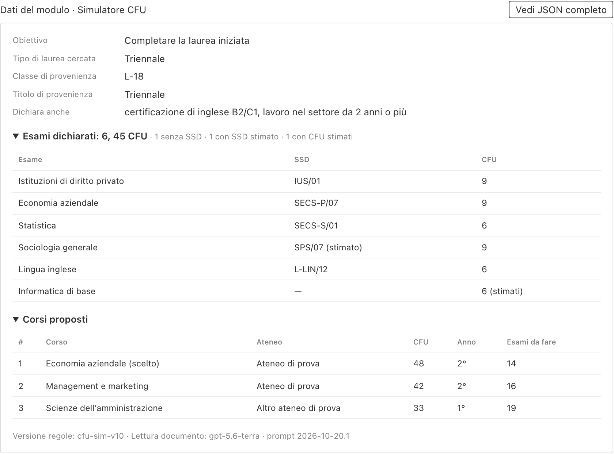
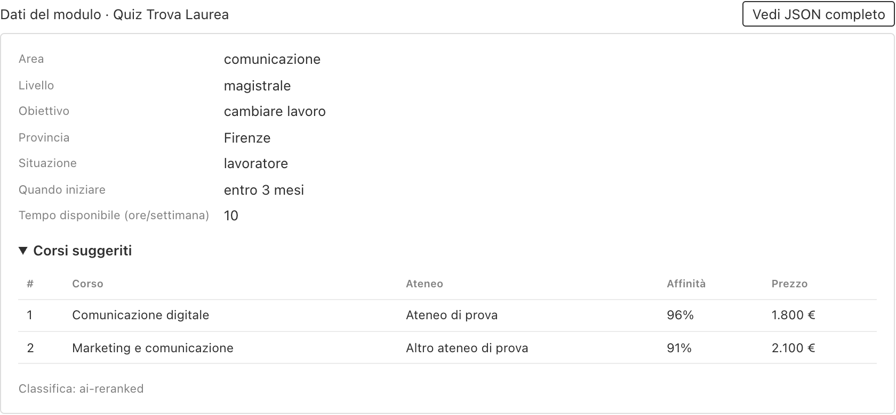
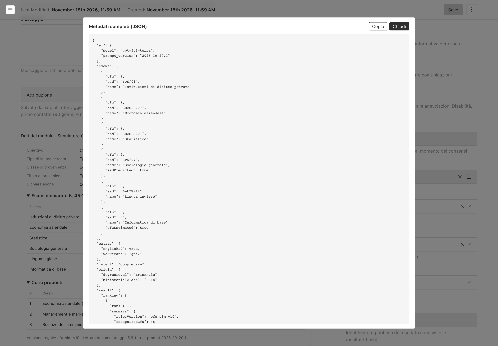

Il campo **Metadati** contiene le informazioni salvate dal sito all'invio del form, del quiz o del simulatore. Nella scheda del lead non lo vedi più come JSON grezzo: lo trovi riassunto nel riquadro **Dati del modulo**.

## Dove trovarlo

1. Apri **👥 Utenti & CRM → Leads**
2. Clicca su un lead
3. Nella tab **Lead**, scorri fino al riquadro **Dati del modulo · …**. Accanto al titolo c'è il modulo di provenienza, per esempio *Simulatore CFU* o *Quiz Trova Laurea*

## Simulatore CFU

<Frame caption="Dati del modulo di un lead del simulatore CFU (dati di prova)">
  
</Frame>

| Voce | Cosa dice |
| --- | --- |
| Obiettivo | *Completare la laurea iniziata* o *Iniziare un nuovo percorso* |
| Tipo di laurea cercata | Triennale, magistrale o ciclo unico |
| Classe e titolo di provenienza | Letti dal documento caricato (es. L-18, triennale) |
| Dichiara anche | Certificazione di inglese B2/C1, EIPASS, anni di lavoro nel settore. *Nulla* se non ha dichiarato niente |
| Esami dichiarati | Tabella con esame, SSD e CFU. Nel titolo: quanti esami, quanti CFU, quanti senza SSD, con SSD stimato o con CFU stimati. La tabella parte chiusa: clicca il titolo per aprirla |
| Corsi proposti | Classifica mostrata allo studente: corso, ateneo, CFU riconosciuti, anno di iscrizione, esami da fare. **(scelto)** indica il corso scelto dallo studente |
| Riga in fondo | Versione delle regole del simulatore (es. `cfu-sim-v12`) e modello usato per leggere il documento |

Se qualcosa è andato storto, sopra il riassunto compare un avviso giallo: errore del simulatore, documento letto ma non salvato (va richiesto allo studente) oppure nessun corso della stessa classe da completare.

## Quiz Trova Laurea

<Frame caption="Dati del modulo di un lead del quiz (dati di prova)">
  
</Frame>

Trovi le risposte al quiz (livello, area, obiettivo, situazione, provincia, agevolazioni, tempo disponibile) e la tabella **Corsi suggeriti** con affinità e prezzo, compresa l'agevolazione o la promo applicata.

## Altri moduli

Per prenota consulenza, contatti, richiedi informazioni e gli altri form vedi i valori semplici: corso di interesse, pagina del modulo, provenienza.

## JSON completo

Il pulsante **Vedi JSON completo** apre tutti i metadati in un popup. **Copia** li copia negli appunti; chiudi con **Chiudi**, con Esc o cliccando fuori.

<Frame caption="Popup con il JSON completo">
  
</Frame>

Il riquadro è in sola lettura: i metadati non si modificano dall'admin.

## Chiavi del JSON

Esempi tipici (variano in base al form):

| Chiave | Significato |
| --- | --- |
| `page_url` / `referrer` | Pagina da cui è partita la richiesta |
| `user_agent` | Browser e dispositivo |
| `ip` | Indirizzo IP (se raccolto) |
| `cookie_consent` | Stato consenso cookie |
| `source_form` | Quiz, form o CTA da cui arriva il lead (`trova_laurea_quiz`, `prenota_consulenza`, `contatti`, `richiedi_informazioni`, `piano_di_studi`, `segnalazione_inesattezza`) |
| `entity_id` | Id CMS del percorso (laurea, master, corso). n8n lo usa come `id_sorgente` Aurora |
| `university_id` | Id CMS dell'ateneo. n8n lo mappa sull'id Aurora, non lo copia così com'è |
| `entity_type` | `laurea`, `master`, `corso` o `universita` |
| Dati quiz | Risposte o contesto del test di orientamento. Per Trova Laurea include `quiz_answers.provincia` (`{ id, nome, sigla }`) |
| Simulatore CFU | `source_form: simulatore_cfu`, `intent`, corso scelto in `degreeId` se presente, `extras` (`englishB2`, `computerCert`, `workYears`), `rulesVersion`, esami del libretto, `origin` se letto dal documento, `result.ranking` (scelto + affini oppure top 3 partner, con score %, summary e piano annotato) o `error`. Se c’è elenco: `result_hash`. `metadata.result` alimenta la pagina pubblica (senza contatti né file). Documento: `librettoFile: { id, filename }` (il primo); con più documenti anche `librettoFiles: [{ id, filename }]` e gli altri in **Altri documenti della carriera** (`libretto_extra_files`). Prova lavoro: `workExperience` e in scheda **Prova esperienza lavorativa** (`work_experience_file`). Snapshot più vecchi: `result.destination` + `subjects` + `summary` |

## Come usarlo

- **Supporto commerciale:** capire da quale pagina o flusso è arrivato il contatto
- **Debug:** verificare se un lead proviene dal quiz o da un form specifico

<Warning>
I metadati possono contenere dati sensibili. Non condividere screenshot con informazioni reali nella documentazione pubblica.
</Warning>

## Guide correlate

- [Consultare i Leads](/admin/leads)
- [Esito prevalutazione](/admin/leads#esito-prevalutazione)
- [Tracking UTM](/admin/tracking)
